<div align="center">


# StudyAI

**Sube tu material, define tu meta y deja que la IA arme un plan de estudio que se adapta a cómo aprendes.**

Repetición espaciada · Priorización Pareto · Enseñanza por perfil académico · Ruta adaptativa

<br />


[Qué es](#-qué-es-studyai) ·
[Recorrido](#-recorrido-por-la-aplicación) ·
[Cómo abrirla](#-cómo-abrirla) ·
[Organización](#-organización-del-repositorio) ·
[Decisiones](#-decisiones-de-diseño) ·
[Construcción](#-cómo-está-construida) ·
[Estado y mejoras](#-estado-mejoras-y-recomendaciones) ·
[Licencia](#-licencia-y-autor)

<br />

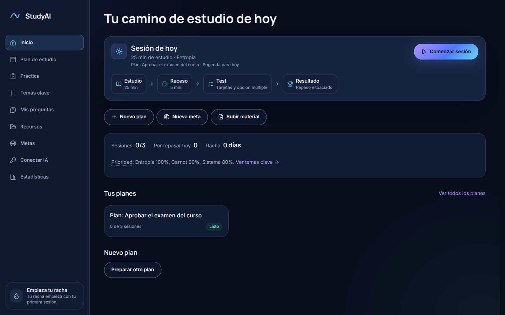

</div>

---

## ✨ ¿Qué es StudyAI?

StudyAI convierte tus apuntes (`.pdf` / `.md`) en un **plan de estudio completo**: sesiones con material, tarjetas,
cuestionarios y un calendario de repasos. Eliges una meta —**examen**, **aprendizaje** o **memorización**— y un
pipeline de varios pasos con LLM decide *qué* estudiar, *en qué orden* y *cuándo repasarlo*.

> **Funciona de fábrica sin claves ni dependencias pesadas.** Usa un proveedor LLM *mock* determinista, un
> *embedder* por hashing y un vector store en memoria. Cuando instalas los extras opcionales y conectas una IA,
> pasa a inferencia real y RAG semántico **sin tocar el código**.

### Funcionalidades

| | |
|---|---|
| 🧠 **Plan generado por IA** | Análisis de temas → selección **Pareto** de los que más rinden → reparto en sesiones con intervalos de **Ebbinghaus** → material, tarjetas y preguntas por sesión. |
| 🎓 **Enseñanza por perfil académico** | Cada tema se clasifica en un perfil de razonamiento (lógico-deductivo, crítico-argumentativo, lingüístico-interpretativo, sistémico-empírico, aplicado-práctico) con objetivos y niveles de Bloom propios. |
| 📝 **Evaluación variada** | Tarjetas, selección única/múltiple, verdadero/falso, emparejamiento, respuesta numérica o corta, ensayo, paso a paso y rúbricas, con retroalimentación fundamentada en tu material. |
| 🔁 **Repetición espaciada** | **SM-2** reprograma cada tarjeta según tu calificación (0–5). |
| 🧭 **Ruta adaptativa** | Un examen ajusta el plan: el dominio por tema se actualiza y se crean repasos de lo que fallaste, sin llamadas al LLM. El refuerzo con IA es opcional y bajo demanda. |
| 💬 **Asistente de estudio** | Panel disponible en cada sesión para preguntar dudas sobre tu material. En modo examen solo da pistas, nunca la respuesta. Tus preguntas quedan en **Mis preguntas**. |
| 🖼️ **Figuras del documento** | Las imágenes de tus PDF se extraen y pueden usarse como estímulo en las preguntas; los SVG generados se sanean antes de mostrarse. |
| ♻️ **Generación reanudable** | Si la generación falla o el servidor se reinicia, el plan queda **Incompleto** y conserva lo hecho; «Continuar generación» pide solo lo que falta. |
| 🆓 **IA gratuita incluida** | Quien no conecta su propia IA usa la del servidor, con un cupo diario por estudiante. |
| 🔑 **Trae tu propia IA** | Anthropic, OpenAI, DeepSeek, Gemini, OpenRouter, NVIDIA NIM, **Ollama local** o tu suscripción mediante agentes de terminal (Claude Code, Codex, OpenCode, Pi). Claves cifradas y verificación antes de activar. |
| 📊 **Estadísticas reales** | Precisión por periodo, racha, temas débiles y próximas revisiones, derivadas de la API. |
| 🛡️ **Seguro por diseño** | Claves cifradas (Fernet), protección SSRF, validación de documentos en servidor y salida del LLM nunca renderizada como URL, HTML o SVG inline. |

## 🖥️ Recorrido por la aplicación

Capturas tomadas con la app corriendo en **modo demo** (sin claves). El texto de ejemplo del material es contenido
simulado; con una IA conectada lo reemplaza contenido real basado en tus documentos.

### 1. Landing

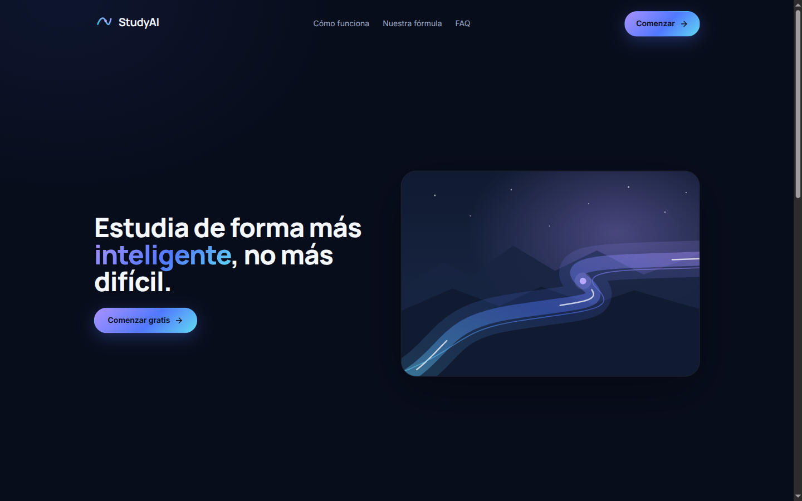

La entrada pública (`/`) explica la propuesta y lleva a **Inicio**; `/demo` muestra una versión simulada que no llama a la API.

### 2. Preparar un plan en cuatro pasos: Material → Meta → IA → Estudiar

Desde **Inicio** un asistente guía el primer plan. Cada paso se valida antes de dejar continuar y se puede volver atrás.

| Paso 2 · Meta | Paso 3 · IA |
|---|---|
| 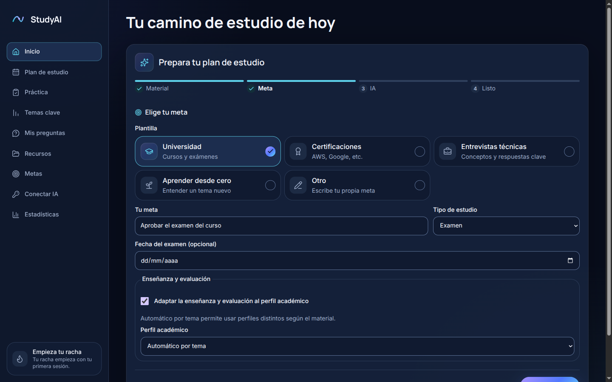 | 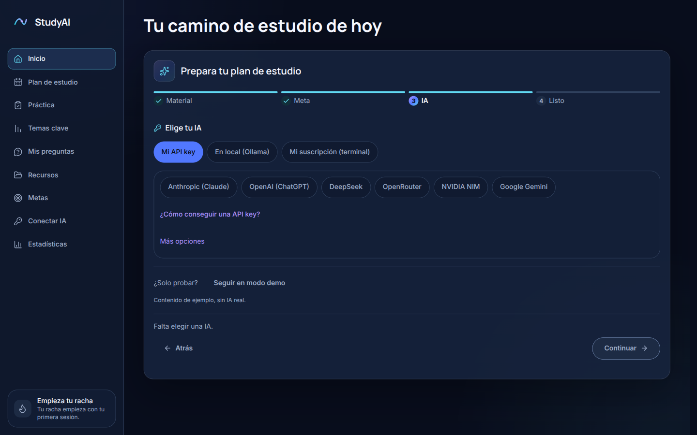 |
| Plantillas (Universidad, Certificaciones, Entrevistas técnicas, Aprender desde cero u otra propia), tipo de estudio, fecha de examen opcional y enseñanza adaptada al perfil académico. | Tu API key, un modelo local con Ollama o tu suscripción desde la terminal. Si solo quieres probar, «Seguir en modo demo». |

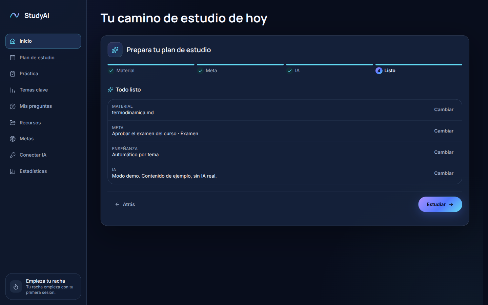

El paso final resume material, meta, enseñanza e IA, y cada dato se puede cambiar. «Estudiar» genera el plan en
segundo plano mostrando la etapa real («Preparando la sesión N de M»).

### 3. Inicio, plan y sesiones

| Inicio | Plan de estudio |
|---|---|
|  | 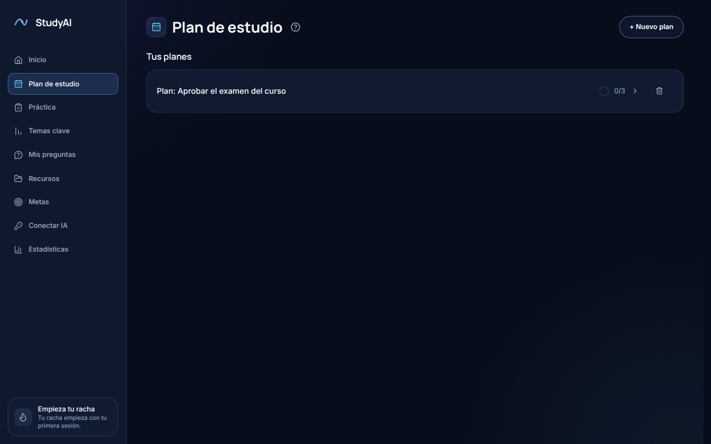 |
| Sesión de hoy (estudio → receso → test → resultado), accesos rápidos, progreso, racha y temas prioritarios. | Todos tus planes con su progreso y el estado de generación. |

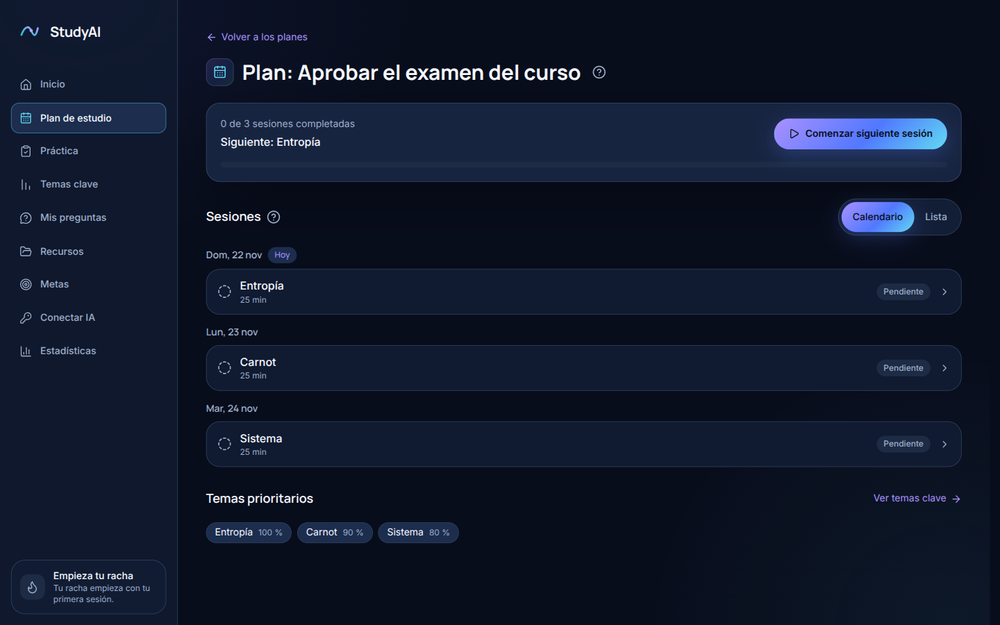

El detalle del plan muestra el calendario o la lista de sesiones, lo completado y el acceso directo a la siguiente
sesión y a los temas clave.

### 4. Estudiar y evaluarse

| Sesión de estudio | Test |
|---|---|
| 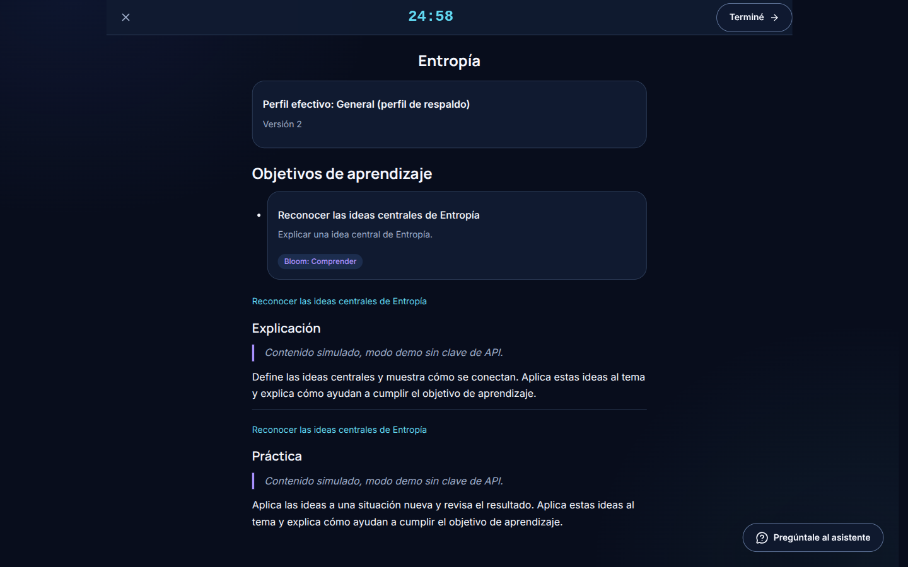 | 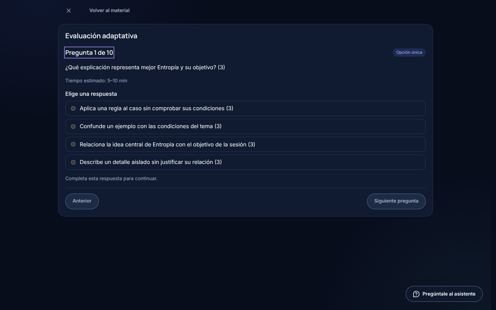 |
| Pantalla sin distracciones con temporizador de 25 min, objetivos de aprendizaje con su nivel de Bloom y material por bloques. El asistente está siempre a un clic. | Evaluación adaptativa con tipos de pregunta mezclados en un orden estable. Las respuestas de opción múltiple se corrigen al instante y alimentan SM-2 y la ruta adaptativa. |

### 5. Temas, práctica y estadísticas

| Temas clave | Práctica |
|---|---|
| 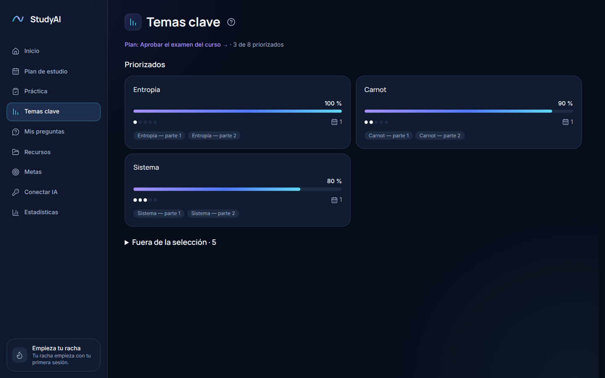 | 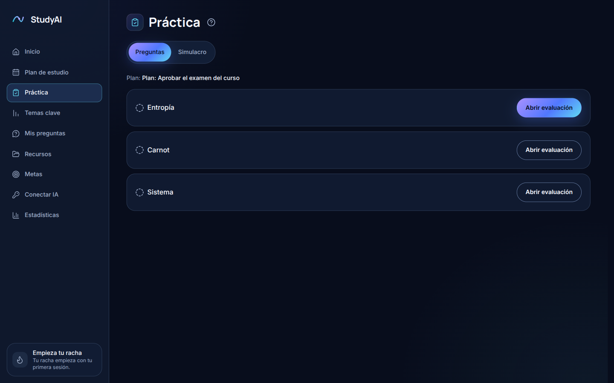 |
| Relevancia, dificultad y selección **Pareto**: dónde invertir primero tu tiempo. | Preguntas locales que no registran resultados y simulacro con el test real de la sesión. |

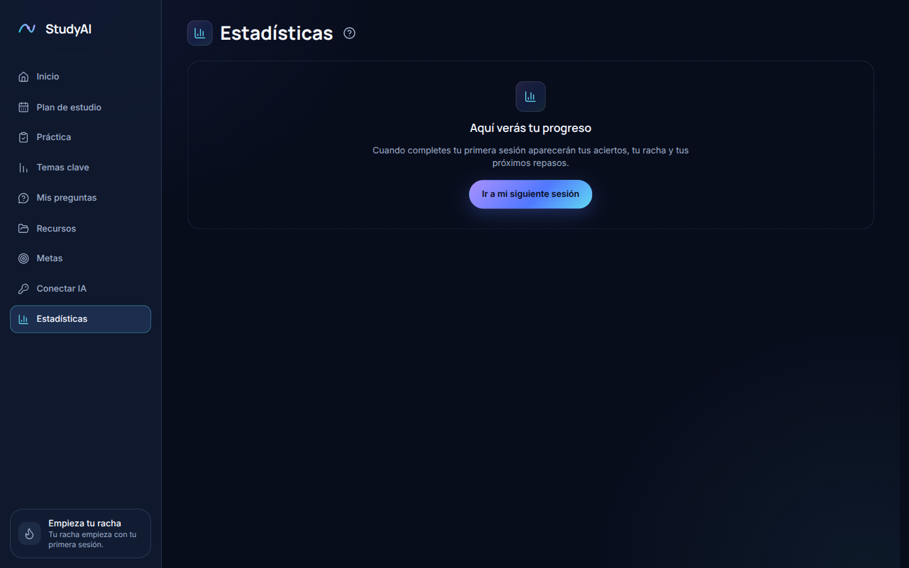

### 6. Recursos y conexión de la IA

| Recursos | Conectar IA |
|---|---|
| 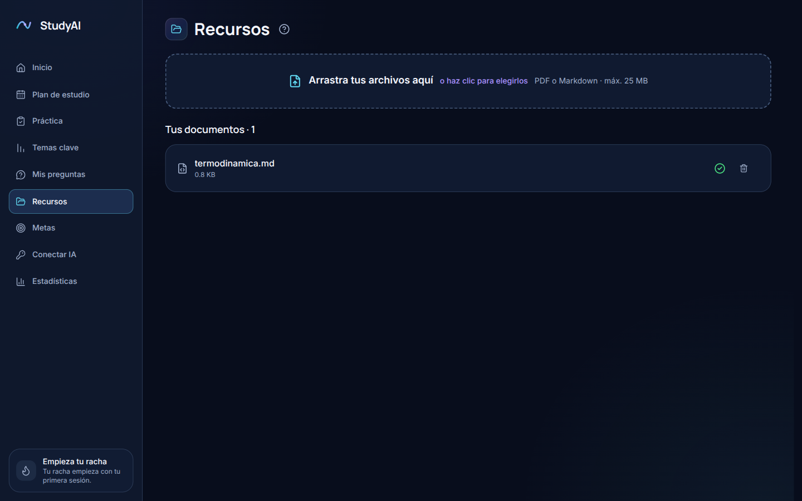 | 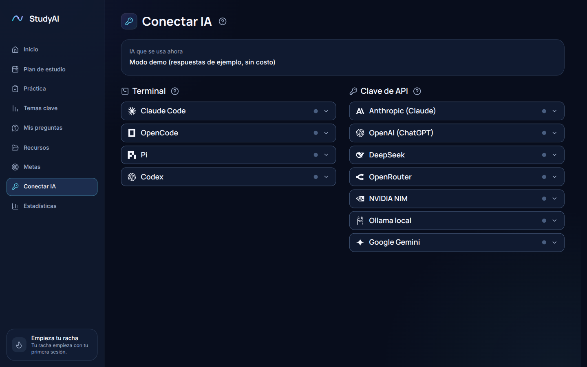 |
| Tus documentos y su estado de indexación (`PENDING → INDEXED`). | Catálogo de proveedores, estado de la IA activa y ciclo guardar → verificar → activar. |

## 🚀 Cómo abrirla

**Requisitos:** Python ≥ 3.11 y Node.js ≥ 22.

```bash
# 1 · Backend  → http://localhost:8001  (Swagger en /docs)
cd backend
python -m venv .venv && source .venv/bin/activate
pip install -r requirements.txt
cp .env.example .env
uvicorn main:app --reload --port 8001

# 2 · Frontend → http://localhost:5173
cd frontend
npm install
cp .env.example .env
npm run dev
```

Abre <http://localhost:5173>, entra a **Inicio** y sigue el asistente. Sin ninguna clave verás el **modo demo**
(contenido simulado) para recorrer todo el flujo.

<details>
<summary><b>Extras opcionales</b> — RAG semántico real, PDF con figuras y Postgres</summary>

```bash
pip install -r requirements-rag.txt    # PyMuPDF, sentence-transformers, ChromaDB (incluye torch)
pip install -r requirements-dev.txt    # pytest, httpx, respx
pip install -r requirements-saas.txt   # psycopg 3, para Postgres
```

Se detectan en tiempo de ejecución; si faltan, StudyAI degrada en silencio al respaldo en Python puro.
</details>

### Pruebas

```bash
cd backend  && python -m pytest -q                     # backend
cd frontend && npm run lint && npm test                # frontend (npm run build si tocas configuración)
npm --prefix frontend run test:qa                      # QA aislado contra el backend real en modo demo
```

Los tests fuerzan el LLM mock y directorios temporales: **nunca tocan datos reales ni gastan tokens**. Guía del
entorno aislado: [`docs/frontend/qa/qa-aislado.md`](docs/frontend/qa/qa-aislado.md).

## 🗂️ Organización del repositorio

Monorepo con separación estricta por capas: **Controllers → Services → Repositories → Models/DTOs**.

```
studyai/
├── backend/                  # FastAPI + SQLAlchemy 2 + Pydantic v2
│   ├── main.py               # App factory (uvicorn main:app)
│   └── app/
│       ├── api/v1/routes/    # documents, goals, plans, sessions, quizzes, dashboard, llm-settings, adaptive, assistant
│       ├── services/         # Orquestación y lógica de negocio
│       ├── repositories/     # Acceso a datos (Repository)
│       ├── models/ schemas/  # Entidades ORM y DTOs
│       ├── processors/       # Parseo PDF / Markdown (Factory) + pipeline de ingesta
│       ├── rag/              # Chunker, Embedder, VectorStore, Retriever
│       ├── llm/              # Proveedores, registro, harness de agentes CLI, prompts y parsers
│       ├── pedagogy/         # Perfiles académicos, estímulos y saneado de SVG
│       ├── strategies/       # Estrategia por tipo de meta (Strategy)
│       ├── algorithms/       # SM-2, Pareto, ruta adaptativa
│       ├── events/           # Bus de eventos de sesión (Observer)
│       └── core/             # Config, logging, seguridad, excepciones
├── frontend/                 # Vite + React 18 + TypeScript + Tailwind + TanStack Query
│   └── src/{pages,components,api,hooks,lib,demo,styles}
├── docs/                     # Documentación por área, contrato OpenAPI y recursos de este README
├── plans/                    # Planes de trabajo agénticos por fases
└── odd/                      # Registros de verificación
```

### Rutas de la interfaz

| Ruta | Pantalla |
|---|---|
| `/` · `/demo` | Landing y demostración simulada |
| `/inicio` | Sesión de hoy, accesos rápidos, progreso y asistente Material → Meta → IA → Estudiar |
| `/plan`, `/plan/:id` | Planes con vista Calendario / Lista y progreso de generación |
| `/session/:id` | Estudio → receso → test → resultado (`?fase=test` abre el test) |
| `/practica` | Preguntas locales sin guardar y simulacro |
| `/temas` · `/preguntas` | Temas clave con Pareto · historial del asistente |
| `/documents` · `/goals` | Recursos y metas |
| `/dashboard` · `/settings` | Estadísticas · Conectar IA |

## 🧭 Decisiones de diseño

Lo que hace a StudyAI distinto no es la lista de pantallas, sino las decisiones que hay detrás:

1. **Funciona sin nada y mejora sola.** El *modo demo* no es un adorno: es un invariante. Cada pieza pesada tiene
   una versión real y otra en Python puro con la misma interfaz, elegida en tiempo de ejecución. Quien clona el
   repo lo ve funcionar completo en un minuto y, si instala los extras, no cambia una línea.

   | Componente | Real | Respaldo |
   |---|---|---|
   | Embeddings | sentence-transformers (384-d) | *Hashing embedder* determinista |
   | Vector store | ChromaDB persistente (o pgvector) | Almacén en memoria con persistencia JSON |
   | Chunker | LangChain splitter | Splitter en Python puro |
   | PDF | PyMuPDF / pymupdf4llm | Carga diferida (no rompe el arranque) |
   | LLM | Anthropic, OpenAI, DeepSeek, Gemini, OpenRouter, NVIDIA, Ollama, agentes CLI | `MockLLMProvider` |

2. **Pocas llamadas al LLM, y reanudables.** Generar un plan cuesta **`2 + N` llamadas** (N = sesiones): una para
   analizar los temas, una para repartirlos y una por sesión. Se confirma cada paso, así que un fallo nunca deja
   un plan atascado: se retoma exactamente donde quedó.
3. **La ruta adaptativa no usa IA.** Tras el primer test, el dominio por tema se actualiza con una media móvil y
   cajas de Leitner, y se crea como máximo un repaso por tema con lo fallado primero. Es determinista, barata y
   auditable. La IA solo entra si el estudiante pide **Reforzar con IA**.
4. **Pareto + Ebbinghaus + SM-2.** Priorizar los temas de mayor rendimiento, espaciar los repasos con intervalos
   de olvido y reprogramar las tarjetas según el desempeño real.
5. **Enseñanza por perfil académico, opt-in.** Un tema de derecho no se estudia como uno de cálculo. Cada sesión
   guarda su perfil, sus objetivos, sus niveles de Bloom y la configuración con la que se generó.
6. **Honestidad pedagógica.** Los casos inventados se marcan como *ejemplos generados*, las citas se limitan a
   fragmentos recuperados y la nota solo cuenta preguntas con clave exacta; lo escrito se contrasta con rúbrica.
7. **Trae tu propia IA, sin perder el control.** El flujo de credenciales es revisionado y lo exige el backend:
   guardar clave → guardar borrador → verificar → activar. Solo una revisión con evidencia vigente puede activarse.
8. **Seguridad que no se negocia.** Claves cifradas que nunca salen del servidor, `base_url` validada contra SSRF y
   salida del LLM nunca renderizada como URL, HTML o SVG inline (los enlaces de YouTube se construyen como búsqueda).
9. **Borrados sin sorpresas.** Eliminar una meta es un borrado lógico: conserva planes y práctica. Eliminar un plan
   o un documento es explícito y completo (SQLite sin claves foráneas, ver `docs/backend/arquitectura/base-de-datos.md`).
10. **Interfaz de inmersión.** Tema oscuro tipo «lámpara en un cuarto oscuro», una sola acción principal por pantalla,
    foco que se mueve por fases y movimiento corto que respeta `prefers-reduced-motion`.

### Conectar tu IA: orden de prioridad

1. **Tu propia IA** (sección **Conectar IA**, `/settings`).
2. **Clave del servidor** (`ANTHROPIC_API_KEY` en `.env`).
3. **IA gratuita incluida** (DeepSeek del servidor, `FREE_AI_DAILY_LIMIT` usos al día por estudiante).

Si nada de lo anterior está disponible, se usa el **modo demo**.

<details>
<summary><b>Notas por proveedor</b></summary>

- **Razonamiento apagado o mínimo** (Ollama y NVIDIA `reasoning_effort: "none"`, DeepSeek `thinking` desactivado,
  Gemini 3.x `thinkingLevel` mínimo) para que los tokens de salida alcancen para el JSON. Si el modelo se queda sin
  espacio, se reintenta **una vez** con el doble (tope 8192).
- **Ollama** necesita al menos **16 384 tokens de contexto**: `OLLAMA_CONTEXT_LENGTH=16384 ollama serve`. La tarjeta
  descubre los modelos instalados y excluye `:cloud`. Dentro de Docker, `OLLAMA_BASE_URL` debe resolver hacia el host.
- **DeepSeek**: clave en <https://platform.deepseek.com/api_keys>; modelos `deepseek-flash` (por defecto) y
  `deepseek-v4-pro`. No admite URL base personalizada.
- **NVIDIA NIM** usa siempre `https://integrate.api.nvidia.com/v1` y solo modelos con contrato validado en el servidor.
  No repite un POST tras un `202`.
- **OpenAI y OpenRouter** permiten una URL base personalizada (validada contra SSRF).
- **Agentes de terminal** (Claude Code, Codex, OpenCode, Pi): usan tu suscripción local; los tests nunca invocan un CLI real.
- Los fallos de proveedor se exponen como `502` con `code`, `provider`, `upstream_status`, `retryable` y
  `retry_after_seconds`, sin cuerpos de respuesta, prompts ni claves. Un 429 temporal respeta `Retry-After`.
</details>

## 🏗️ Cómo está construida

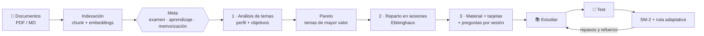

**Patrones en uso** (cada uno sostiene algo concreto):

| Patrón | Dónde | Para qué |
|---|---|---|
| **Repository** | `app/repositories/` | Aislar el acceso a datos; las rutas nunca tocan el ORM |
| **Factory** | Procesadores, proveedores LLM, estrategias de meta | Elegir implementación por tipo sin `if` repartidos |
| **Strategy** | `GoalStrategy` (examen, aprendizaje, memorización) | Da forma al prompt y a la configuración de cada sesión |
| **Pipeline** | Ingesta: Validate → Parse → Describe → Chunk → Embed → Store | Pasos encadenables y degradables |
| **Observer** | `EventBus` (`session.completed`) | Completar una sesión actualiza SM-2 sin acoplar servicios |
| **Registry** | `app/llm/provider_registry.py` | Único punto de ensamblaje de proveedores LLM |
| **Fallback dual** | Embedder, vector store, chunker, PDF, LLM | Modo demo completo sin dependencias pesadas |

**Frontend.** SPA con React 18 y TypeScript estricto; estado del servidor con TanStack Query, estilos con Tailwind
sobre tokens semánticos de color, iconos Lucide y animaciones de entrada con WAAPI. Muestra solo datos reales (los
widgets sin contrato viven únicamente en `/demo`), evita duplicados («Estudiar» envía `Idempotency-Key`), distingue
errores de vacíos y renderiza el Markdown del LLM sin enlaces ni imágenes externas. En móvil, la barra inferior
agrupa Inicio, Plan, Práctica y Estadísticas, y cada página trae una guía «¿Cómo funciona?».

**Backend.** FastAPI con SQLAlchemy 2 y Pydantic v2. SQLite en modo WAL por defecto y Postgres (con pgvector y RLS)
para un despliegue SaaS. Una sola fuente de configuración (`pydantic-settings`), generación en segundo plano con
recuperación de planes interrumpidos al arrancar y contrato OpenAPI mantenido en [`docs/api_contract.yaml`](docs/api_contract.yaml).

### API

Contrato completo en [`docs/api_contract.yaml`](docs/api_contract.yaml) y en vivo en `/docs`.

| Método | Ruta | Descripción |
|---|---|---|
| `GET` | `/health` | Health check |
| `POST` | `/documents/upload` | Sube e indexa un documento |
| `GET` · `DELETE` | `/documents` · `/documents/{id}` | Lista, detalle (polling) y borrado completo |
| `POST` · `GET` · `PUT` · `DELETE` | `/goals` · `/goals/{id}` | Metas (borrar una conserva sus planes) |
| `POST` | `/plans/generate` | Inicia la generación asíncrona; exige documentos propios e indexados y respeta `FREE_AI_DAILY_LIMIT` |
| `GET` | `/plans` · `/plans/{id}` · `/plans/{id}/status` | Lista, plan completo y estado con progreso |
| `POST` | `/plans/{id}/resume` | Continúa un plan `FAILED` |
| `DELETE` | `/plans/{id}` | Elimina el plan con sesiones, quizzes y repasos |
| `GET` · `POST` | `/sessions/{id}` · `/sessions/{id}/complete` | Detalle y cierre de sesión |
| `GET` | `/sessions/{id}/learning-mode` · `/learning-v2` · `/result` | Versión del contenido, lección adaptativa y último resultado |
| `POST` | `/sessions/{id}/reinforcement` · `/reinforcement/cancel` | Refuerzo con IA de un repaso |
| `GET` · `POST` | `/quizzes/{session_id}` · `/quizzes/{quiz_id}/submit` | Quiz clásico: preguntas, envío, calificación y SM-2 |
| `GET` · `POST` | `/quizzes/{session_id}/assessment-v2` · `…/assessment-v2/submit` | Evaluación adaptativa |
| `GET` | `/dashboard` | Métricas de progreso |
| `GET` · `PUT` · `PATCH` · `POST` · `DELETE` | `/llm-settings/…` | Catálogo, clave, borrador de modelo, verificación, activación |

### Configuración (`backend/.env`)

<details>
<summary><b>Variables principales</b></summary>

| Variable | Por defecto | Descripción |
|---|---|---|
| `ANTHROPIC_API_KEY` | *(vacío)* | Alternativa del servidor cuando no hay credencial de usuario activa. |
| `DEEPSEEK_API_KEY` | *(vacío)* | Activa la IA gratuita incluida. |
| `DEFAULT_DEEPSEEK_MODEL` | `deepseek-flash` | Modelo de la IA gratuita incluida. |
| `FREE_AI_DAILY_LIMIT` | `3` | Usos diarios (UTC) por estudiante: generar un plan o reforzar un repaso. |
| `LLM_MODEL_PLAN` / `LLM_MODEL_QUIZ` | ver `.env.example` | Modelos de Anthropic para el plan y para el contenido de cada sesión. |
| `LLM_TIMEOUT_SECONDS` / `LLM_TOTAL_BUDGET_SECONDS` | `180` / `600` | Timeout por intento y presupuesto total por llamada. |
| `LLM_MAX_RETRIES` / `LLM_MAX_RATE_LIMIT_RETRIES` | `3` / `6` | Reintentos por errores transitorios y por 429. |
| `LLM_REQUEST_PACING_SECONDS` | `2.0` | Pausa entre llamadas de una generación (se ignora con mock y Ollama). |
| `OLLAMA_BASE_URL` | `http://127.0.0.1:11434` | Endpoint de Ollama visto por el backend. |
| `DATABASE_URL` | `sqlite:///./studyai.db` | SQLite en modo WAL (o Postgres). |
| `CHROMA_PERSIST_DIR` / `UPLOAD_DIR` | `./storage/chroma` / `./storage/uploads` | Persistencia del vector store y de los archivos. |
| `EMBEDDING_MODEL` | `all-MiniLM-L6-v2` | Modelo de embeddings (si instalas RAG). |
| `MAX_UPLOAD_MB` | `25` | Tamaño máximo de subida. |
| `CORS_ORIGINS` | `http://localhost:5173` | Orígenes permitidos, separados por coma. |
| `REVIEW_INTERVALS_DAYS` | `1,3,7,14,30` | Offsets de repaso espaciado. |
| `SESSION_DURATION_MINUTES` | `25` | Duración de una sesión de estudio. |
| `SECRET_KEY` | *(placeholder)* | Deriva la clave Fernet. **Cámbiala antes de producción.** |

Frontend (`frontend/.env`): `VITE_API_URL` (por defecto `http://localhost:8001`). Lista completa en `backend/.env.example`.
</details>

### Seguridad

- Subidas validadas por extensión (`.pdf` / `.md`) y tamaño máximo; acceso a datos solo vía ORM parametrizado.
- Claves de usuario **cifradas en reposo** (Fernet) y nunca devueltas completas: solo un fragmento enmascarado.
- **Protección SSRF** en URLs base personalizadas: se resuelve el host y se rechazan rangos privados, loopback,
  enlace local y la IP de metadatos de nube.
- Un documento ajeno se reporta igual que uno inexistente, sin revelar datos de otros usuarios.
- Los SVG generados se sanean y nunca se renderiza una URL entregada por el LLM.

## 📈 Estado, mejoras y recomendaciones

### Estado

Hoy StudyAI es un **MVP de un solo usuario** (usuario demo fijo) y está completo de punta a punta: ingesta, RAG,
generación `2 + N`, sesiones, evaluación adaptativa, repetición espaciada, asistente, estadísticas y conexión de IA.
La última verificación completa registrada (2026-11-11) fue de 733 pruebas de backend, 391 de frontend, 11 de
navegador y 21 solicitudes de API en QA aislado; el estado detallado por fases está en
[`docs/AGENTS_STATUS.md`](docs/AGENTS_STATUS.md). Desde entonces se añadieron el asistente de estudio, las figuras de
documento y los proveedores por agente de terminal, de modo que conviene volver a correr las suites antes de publicar.

### Mejoras previstas

- [ ] Autenticación real y multiusuario (Supabase), créditos y *rate limiting* propio.
- [ ] Ocultar las respuestas del quiz clásico hasta el envío (la evaluación v2 ya lo hace).
- [ ] Suscripciones ChatGPT Plus/Pro y Claude Pro/Max con contrato oficial.
- [ ] Verificación *live* con cuentas reales de cada proveedor (la suite usa transporte simulado).
- [ ] Revisión pedagógica humana del [piloto de perfiles académicos](docs/backend/generacion-planes/piloto-perfiles.md).
- [ ] Optimizar el chunk JS del frontend (~525 kB minificado) y el consumo de tokens con PDF grandes.
- [ ] Despliegue de la beta (Cloudflare Pages + AWS Lightsail + Supabase + R2).

### Recomendaciones

- **Antes de exponerla en internet:** cambia `SECRET_KEY`, restringe `CORS_ORIGINS` y no la publiques como
  multiusuario hasta tener autenticación: todos los datos pertenecen hoy al usuario demo.
- **Para una mejor experiencia:** conecta una IA real y instala `requirements-rag.txt`; el modo demo sirve para
  recorrer el flujo, no para estudiar con calidad.
- **Con Ollama:** usa al menos 16 384 tokens de contexto o la generación fallará por falta de espacio.
- **Para contribuir:** lee [`CLAUDE.md`](CLAUDE.md) y [`docs/README.md`](docs/README.md) (mapa «si tocas este código →
  lee este documento») y mantén intacto el camino de respaldo en `llm/`, `rag/` y `processors/`.

### Documentación

- [`docs/README.md`](docs/README.md): índice de la documentación por área.
- [`docs/api_contract.yaml`](docs/api_contract.yaml): contrato OpenAPI.
- [`docs/AGENTS_STATUS.md`](docs/AGENTS_STATUS.md): estado y pendientes.
- [`docs/backend/historial.md`](docs/backend/historial.md) · [`docs/frontend/historial.md`](docs/frontend/historial.md): lo ya ejecutado.
- [`docs/backend/despliegue/saas-produccion.md`](docs/backend/despliegue/saas-produccion.md): hoja de ruta hacia SaaS de pago.

## 📄 Licencia y autor

Distribuido bajo la licencia **MIT**; consulta el archivo [`LICENSE`](LICENSE).

**Autor:** Diego Román · [@DiegoRomanP](https://github.com/DiegoRomanP)

---

<div align="center">

Hecho con FastAPI, React y mucha repetición espaciada.

</div>
