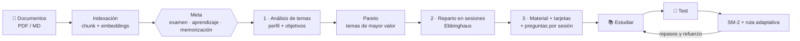

<div align="center">


# StudyAI

**Sube tu material, define tu meta y deja que la IA arme un plan de estudio que se adapta a cómo aprendes.**

Repetición espaciada · Priorización Pareto · Enseñanza por perfil académico · Ruta adaptativa


[Inicio rápido](#-inicio-rápido) ·
[Características](#-características) ·
[Arquitectura](#-arquitectura) ·
[Conectar tu IA](#-conectar-tu-ia) ·
[API](#-api) ·
[Documentación](#-documentación)

<br />


</div>

---

## ✨ ¿Qué es StudyAI?

StudyAI convierte tus apuntes (`.pdf` / `.md`) en un **plan de estudio completo**: sesiones con material,
tarjetas, cuestionarios y un calendario de repasos. Eliges una meta —**examen**, **aprendizaje** o
**memorización**— y un pipeline de varios pasos con LLM decide *qué* estudiar, *en qué orden* y *cuándo repasarlo*.

> **Funciona de fábrica sin claves ni dependencias pesadas.** Usa un proveedor LLM *mock* determinista, un
> *embedder* por hashing y un vector store en memoria. Cuando instalas los extras opcionales y conectas una IA,
> pasa a inferencia real y RAG semántico **sin tocar el código**.

## 🚀 Características

| | |
|---|---|
| 🧠 **Plan generado por IA** | Análisis de temas → selección **Pareto** de los temas que más rinden → reparto en sesiones con intervalos de **Ebbinghaus** → material, tarjetas y preguntas por sesión. |
| 🎓 **Enseñanza por perfil académico** | Cada tema se clasifica en un perfil de razonamiento (lógico-deductivo, crítico-argumentativo, lingüístico-interpretativo, sistémico-empírico, aplicado-práctico) con objetivos y niveles de Bloom propios. |
| 📝 **Evaluación variada** | Tarjetas, selección única/múltiple, verdadero/falso, emparejamiento, respuesta numérica o corta, ensayo, paso a paso y rúbricas, con retroalimentación fundamentada en tu material. |
| 🔁 **Repetición espaciada** | **SM-2** actualiza la programación de cada tarjeta según tu calificación (0–5). |
| 🧭 **Ruta adaptativa** | Un examen ajusta el plan: el dominio por tema se actualiza y se crean repasos de lo que fallaste. Sin llamadas al LLM; el refuerzo con IA es opcional y bajo demanda. |
| ♻️ **Generación reanudable** | Si la generación falla o el servidor se reinicia, el plan queda **Incompleto** y conserva lo hecho. «Continuar generación» pide solo lo que falta. |
| 🆓 **IA gratuita incluida** | Quien no conecta su propia IA usa la del servidor, con un cupo diario por estudiante. |
| 🔑 **Trae tu propia IA** | Anthropic, OpenAI, DeepSeek, Gemini, OpenRouter, NVIDIA NIM u **Ollama local**, con claves cifradas y verificación antes de activar. |
| 📊 **Estadísticas reales** | Precisión por periodo, racha, temas débiles y próximas revisiones, derivadas de la API. |
| 🛡️ **Seguro por diseño** | Claves cifradas (Fernet), protección SSRF, validación de documentos en servidor y enlaces de YouTube construidos solo como búsquedas. |

## ⚡ Inicio rápido

**Requisitos:** Python ≥ 3.11 y Node.js ≥ 22.

```bash
# 1 · Backend  → http://localhost:8001  (Swagger en /docs)
cd backend
python -m venv .venv && source .venv/bin/activate
pip install -r requirements.txt
cp .env.example .env
uvicorn main:app --reload --port 8001

# 2 · Frontend → http://localhost:5173
cd frontend
npm install
cp .env.example .env
npm run dev
```

Abre <http://localhost:5173>, entra a **Inicio** y sigue el asistente: **Material → Meta → IA → Estudiar**.
Sin ninguna clave verás el **modo demo** (contenido simulado) para recorrer todo el flujo.

<details>
<summary><b>Extras opcionales</b> — RAG semántico real y parseo de PDF</summary>

```bash
pip install -r requirements-rag.txt   # PyMuPDF, sentence-transformers, ChromaDB (incluye torch)
pip install -r requirements-dev.txt   # pytest, httpx, respx
```

Se detectan en tiempo de ejecución; si faltan, StudyAI degrada en silencio al respaldo en Python puro.
</details>

## 🧩 Cómo funciona



Generar un plan cuesta **`2 + N` llamadas** al LLM (N = número de sesiones). Cada llamada pide solo los tokens que
necesita, hay una pausa configurable entre llamadas para no agotar los límites de planes gratuitos y todo se
confirma paso a paso, así que un fallo nunca deja un plan atascado.

### Flujo de uso

1. **Sube documentos** (`.pdf` / `.md`); se indexan en segundo plano (`PENDING → INDEXED`). Un plan solo
   acepta documentos tuyos ya indexados.
2. **Elige una meta**: una plantilla (Universidad, Certificaciones, Entrevistas técnicas, Aprender desde
   cero, Otro) o una guardada.
3. **Estudiar** genera el plan (`PROCESSING → READY`) mostrando la etapa real: «Preparando la sesión N de M».
4. **Estudia una sesión**: material → receso → test. Las respuestas de opción múltiple se corrigen al instante.
5. **Repasa**: las tarjetas reprograman su próximo repaso y un examen puede añadir repasos de refuerzo.
6. **Practica** en `/practica` sin registrar resultados, o haz el **simulacro** (el test real de la sesión).

### Enseñanza por perfil académico

Activa «Adaptar la enseñanza y evaluación al perfil académico» al generar. **Automático por tema** puede elegir un
perfil distinto para cada tema del mismo documento, o puedes fijar uno. Cada sesión guarda sus objetivos, niveles
de Bloom, formatos y la configuración con la que se generó; los diagramas incluyen descripción o tabla, los casos
inventados se marcan como *ejemplos generados* y las citas se limitan a los fragmentos recuperados.
La nota y el desglose por objetivo cuentan solo las preguntas con clave exacta; las respuestas escritas se
contrastan después con una rúbrica.

### Ruta adaptativa y refuerzo con IA

Al entregar el **primer** test de una sesión, el dominio por tema se actualiza (media móvil + cajas de Leitner) y
se crea, como máximo, un repaso pendiente por tema, con las preguntas falladas primero. Si lo pides, **Reforzar
con IA** genera un reemplazo con exactamente una llamada y abre una nueva revisión de la evaluación conservando
perfil y objetivos.

## 🏗️ Arquitectura

Monorepo con separación estricta por capas: **Controllers → Services → Repositories → Models/DTOs**.

```
studyai/
├── backend/                  # FastAPI + SQLAlchemy 2 + Pydantic v2
│   ├── main.py               # App factory (uvicorn main:app)
│   └── app/
│       ├── api/v1/routes/    # documents, goals, plans, sessions, quizzes, dashboard, llm-settings, adaptive
│       ├── services/         # Orquestación y lógica de negocio
│       ├── repositories/     # Acceso a datos (Repository)
│       ├── models/ schemas/  # Entidades ORM y DTOs
│       ├── processors/       # Parseo PDF / Markdown (Factory) + pipeline de ingesta
│       ├── rag/              # Chunker, Embedder, VectorStore, Retriever
│       ├── llm/              # Proveedores, registro, prompts y parsers
│       ├── strategies/       # Estrategia por tipo de meta (Strategy)
│       ├── algorithms/       # SM-2, Pareto, ruta adaptativa
│       ├── events/           # Bus de eventos de sesión (Observer)
│       └── core/             # Config, logging, seguridad, excepciones
├── frontend/                 # Vite + React 18 + TypeScript + Tailwind + TanStack Query
│   └── src/{pages,components,api,hooks,lib,demo,styles}
├── docs/                     # Contrato OpenAPI, historiales, QA y hoja de ruta SaaS
└── odd/                      # Planes y registros de verificación
```

**Patrones en uso:** Repository · Factory (procesadores, LLM, estrategias) · Strategy (tipo de meta) ·
Pipeline (ingesta RAG) · Observer (`session.completed`).

**Dual-implementation con respaldo.** Cada pieza pesada tiene una versión real y otra en Python puro con la
misma interfaz, elegida en tiempo de ejecución:

| Componente | Real | Respaldo |
|---|---|---|
| Embeddings | sentence-transformers (384-d) | *Hashing embedder* determinista |
| Vector store | ChromaDB persistente | Almacén en memoria con persistencia JSON |
| Chunker | LangChain splitter | Splitter en Python puro |
| PDF | PyMuPDF | Carga diferida (no rompe el arranque) |
| LLM | Anthropic, OpenAI, DeepSeek, Gemini, OpenRouter, NVIDIA, Ollama | `MockLLMProvider` |

### Interfaz web

Tema oscuro «flow» con tokens semánticos, iconos Lucide y transiciones que respetan `prefers-reduced-motion`.

| Ruta | Pantalla |
|---|---|
| `/` · `/demo` | Landing y demostración simulada (no llama a la API ni pide claves) |
| `/inicio` | Sesión de hoy, accesos rápidos, progreso y asistente plegable Material → Meta → IA → Estudiar |
| `/plan`, `/plan/:id` | Planes con vista Calendario / Lista y progreso de generación |
| `/session/:id` | Estudio → receso → test → resultado (`?fase=test` abre el test) |
| `/practica` | «Preguntas» locales sin guardar y «Simulacro» |
| `/temas` | Relevancia, dificultad y selección Pareto |
| `/documents` · `/goals` | Recursos y metas |
| `/dashboard` | Estadísticas |
| `/settings` | Conectar IA |

Criterios que mantiene: **solo datos reales** (los widgets sin contrato viven únicamente en `/demo`), **sin
duplicados** («Estudiar» envía `Idempotency-Key`), **errores distintos de vacío**, fechas UTC interpretadas con
`parseApiDate` y Markdown del LLM renderizado sin enlaces ni imágenes externas. En móvil, la barra inferior
muestra Inicio, Plan, Práctica y Estadísticas, y cada página trae una guía «¿Cómo funciona?» que se puede cerrar.

## 🔑 Conectar tu IA

Hay tres formas de generar, en este orden de prioridad:

1. **Tu propia IA** (sección **Conectar IA**, `/settings`): Anthropic, OpenAI, DeepSeek, Gemini, OpenRouter,
   NVIDIA NIM u Ollama local.
2. **Clave del servidor** (`ANTHROPIC_API_KEY` en `.env`).
3. **IA gratuita incluida** (DeepSeek del servidor, `FREE_AI_DAILY_LIMIT` usos al día por estudiante).
   Si nada de lo anterior está disponible, se usa el **modo demo** (mock).

El flujo de configuración es revisionado y lo exige el backend:

| Paso | Qué ocurre |
|---|---|
| **1 · Guardar clave** | Se cifra y se guarda sin probar ningún modelo. |
| **2 · Guardar borrador** | Eliges modelo y, si aplica, URL base. Crea una revisión nueva e invalida pruebas previas. |
| **3 · Verificar** | Prueba exactamente el borrador guardado. Si falla, conserva el borrador. |
| **4 · Activar** | Solo una revisión con evidencia vigente puede activarse. |

<details>
<summary><b>Notas por proveedor</b></summary>

- **Generación con razonamiento apagado o mínimo** (Ollama y NVIDIA `reasoning_effort: "none"`, DeepSeek
  `thinking` desactivado, Gemini 3.x `thinkingLevel` mínimo) para que los tokens de salida alcancen para el JSON.
  Si el modelo se queda sin espacio, se reintenta **una vez** con el doble (tope 8192). Tras actualizar, vuelve
  a **Probar** las credenciales propias de Gemini 3.
- **Ollama** necesita al menos **16 384 tokens de contexto**:
  `OLLAMA_CONTEXT_LENGTH=16384 ollama serve`. La tarjeta descubre los modelos instalados y excluye `:cloud`.
  Dentro de Docker, `OLLAMA_BASE_URL` debe resolver hacia el host.
- **DeepSeek**: clave en <https://platform.deepseek.com/api_keys>; modelos `deepseek-flash` (por defecto) y
  `deepseek-v4-pro`. No admite URL base personalizada.
- **NVIDIA NIM** usa siempre `https://integrate.api.nvidia.com/v1` y solo modelos con contrato validado en el
  servidor (hoy `nvidia/nemotron-3-super-120b-a12b`). No repite un POST tras un `202`.
- **OpenAI y OpenRouter** permiten una URL base personalizada (validada contra SSRF); los modelos o-series
  reciben `max_completion_tokens`.
- Los modelos sugeridos se ordenan con los **gratuitos primero**.
- Los fallos de proveedor se exponen como `502` con `code`, `provider`, `upstream_status`, `retryable` y
  `retry_after_seconds`, sin cuerpos de respuesta, prompts ni claves. Un 429 temporal respeta `Retry-After`.
</details>

## ⚙️ Configuración (`backend/.env`)

<details>
<summary><b>Variables principales</b></summary>

| Variable | Por defecto | Descripción |
|---|---|---|
| `ANTHROPIC_API_KEY` | *(vacío)* | Alternativa del servidor cuando no hay credencial de usuario activa. |
| `DEEPSEEK_API_KEY` | *(vacío)* | Activa la IA gratuita incluida. Se lee del `.env` de la raíz o de `backend/.env` (gana este); una variable exportada en la shell gana a ambos. |
| `DEFAULT_DEEPSEEK_MODEL` | `deepseek-flash` | Modelo de la IA gratuita incluida. |
| `FREE_AI_DAILY_LIMIT` | `3` | Usos diarios (UTC) por estudiante: generar un plan o reforzar un repaso con IA. |
| `LLM_MODEL_PLAN` / `LLM_MODEL_QUIZ` | `claude-opus-4-8` / `claude-haiku-4-5` | Modelos del `.env` de Anthropic para el plan y para el contenido de cada sesión. |
| `LLM_TIMEOUT_SECONDS` | `180` | Timeout por intento de generación. |
| `LLM_TOTAL_BUDGET_SECONDS` | `600` | Presupuesto total por llamada, con intentos y esperas. |
| `LLM_MAX_RETRIES` / `LLM_MAX_RATE_LIMIT_RETRIES` | `3` / `6` | Reintentos por errores transitorios y por 429 temporales. |
| `LLM_REQUEST_PACING_SECONDS` | `2.0` | Pausa entre llamadas de una generación (se ignora con mock y Ollama). |
| `LLM_TEST_*` | ver `.env.example` | Timeouts, presupuesto y reintentos de la prueba de credenciales. |
| `OLLAMA_BASE_URL` | `http://127.0.0.1:11434` | Endpoint de Ollama visto por el backend. |
| `OLLAMA_TIMEOUT_SECONDS` / `OLLAMA_TOTAL_BUDGET_SECONDS` / `OLLAMA_MAX_RETRIES` | `600` / `600` / `1` | Límites de la inferencia local. |
| `DATABASE_URL` | `sqlite:///./studyai.db` | SQLite en modo WAL (`-wal` y `-shm` ignorados por git). |
| `CHROMA_PERSIST_DIR` / `UPLOAD_DIR` | `./storage/chroma` / `./storage/uploads` | Persistencia del vector store y de los archivos. |
| `EMBEDDING_MODEL` | `all-MiniLM-L6-v2` | Modelo de embeddings (si instalas RAG). |
| `MAX_UPLOAD_MB` | `25` | Tamaño máximo de subida. |
| `CORS_ORIGINS` | `http://localhost:5173` | Orígenes permitidos, separados por coma. |
| `REVIEW_INTERVALS_DAYS` | `1,3,7,14,30` | Offsets de repaso espaciado. |
| `SESSION_DURATION_MINUTES` | `25` | Duración de una sesión de estudio. |
| `SECRET_KEY` | *(placeholder)* | Deriva la clave Fernet. **Cámbiala antes de producción.** |

Frontend (`frontend/.env`): `VITE_API_URL` (por defecto `http://localhost:8001`).
</details>

## 🔌 API

Contrato completo en [`docs/api_contract.yaml`](docs/api_contract.yaml) y en vivo en `/docs`.

| Método | Ruta | Descripción |
|---|---|---|
| `GET` | `/health` | Health check |
| `POST` | `/documents/upload` | Sube e indexa un documento |
| `GET` · `DELETE` | `/documents` · `/documents/{id}` | Lista, detalle (polling) y borrado completo |
| `POST` · `GET` · `PUT` · `DELETE` | `/goals` · `/goals/{id}` | Metas (borrar una elimina sus planes en cascada) |
| `POST` | `/plans/generate` | Inicia la generación asíncrona. Exige documentos propios e indexados (`400 PLAN_DOCUMENTS_UNAVAILABLE`) y respeta `FREE_AI_DAILY_LIMIT` (`429`) |
| `GET` | `/plans` · `/plans/{id}` · `/plans/{id}/status` | Lista, plan completo y estado con progreso |
| `POST` | `/plans/{id}/resume` | Continúa un plan `FAILED` (`409` si no es reanudable) |
| `DELETE` | `/plans/{id}` | Elimina el plan con sesiones, quizzes y repasos |
| `GET` · `POST` | `/sessions/{id}` · `/sessions/{id}/complete` | Detalle y cierre de sesión |
| `GET` | `/sessions/{id}/learning-mode` · `/learning-v2` | Versión del contenido y lección adaptativa |
| `GET` | `/sessions/{id}/result` | Último resultado de la sesión |
| `POST` | `/sessions/{id}/reinforcement` · `/reinforcement/cancel` | Refuerzo con IA de un repaso |
| `GET` · `POST` | `/quizzes/{session_id}` · `/quizzes/{quiz_id}/submit` | Quiz clásico: preguntas, envío, calificación y SM-2 |
| `GET` · `POST` | `/quizzes/{session_id}/assessment-v2` · `/assessment-v2/result` · `/quizzes/{quiz_id}/assessment-v2/submit` | Evaluación adaptativa |
| `GET` | `/dashboard` | Métricas de progreso |
| `GET` | `/llm-settings/catalog` · `/runtime` · `/OLLAMA/models` | Catálogo, fuente efectiva (`USER`, `ENV`, `MOCK`) y modelos locales |
| `PUT` · `PATCH` · `DELETE` | `/llm-settings/{provider}` · `/{provider}/model` | Guardar clave, guardar borrador de modelo, eliminar |
| `POST` | `/llm-settings/{provider}/test` · `/activate` · `/deactivate-all` | Verificar, activar o volver al servidor/mock |

## 🧪 Pruebas

```bash
# Backend
cd backend && source .venv/bin/activate && python -m pytest -q

# Frontend
cd frontend && npm test && npm run lint && npm run build

# QA aislado contra el backend real en modo demo (Bruno + Playwright)
npm --prefix frontend run test:qa
```

Los tests del backend fuerzan el LLM mock y directorios temporales: nunca tocan datos reales ni gastan tokens.
Cubren SM-2, Pareto, chunker, parsers, factorías, borrado en cascada, cifrado de claves, transporte y proveedores
(con `respx`, sin red), el ciclo revisionado de `/llm-settings`, la generación `2 + N` y su reanudación, la
evaluación adaptativa y flujos end-to-end. Playwright cubre el recorrido completo (material → plan → test →
estadísticas) y la navegación con teclado a 320 px. La guía del entorno aislado está en
[`docs/frontend/qa/qa-aislado.md`](docs/frontend/qa/qa-aislado.md).

## 🛡️ Seguridad

- Subidas validadas por extensión (`.pdf` / `.md`) y tamaño máximo.
- Acceso a datos solo vía ORM parametrizado.
- Claves de usuario **cifradas en reposo** (Fernet) y nunca devueltas completas: solo un fragmento enmascarado.
- **Protección SSRF** en URLs base personalizadas: se resuelve el host y se rechazan rangos privados, loopback,
  enlace local y la IP de metadatos de nube.
- NVIDIA solo acepta su endpoint oficial y modelos con contrato curado.
- Un documento ajeno se reporta igual que uno inexistente, sin revelar datos de otros usuarios.
- Los enlaces de YouTube se construyen como **búsqueda** desde palabras clave; nunca se renderiza una URL
  generada por el LLM.

## 🗺️ Hoja de ruta

Hoy es un MVP de un solo usuario (usuario demo fijo). Lo que sigue hacia un SaaS: autenticación real con
Supabase, créditos, rate limiting, ocultar las respuestas del quiz hasta el envío y despliegue de la beta
(Cloudflare Pages + AWS Lightsail + Supabase + R2). Detalle en
[`docs/backend/despliegue/saas-produccion.md`](docs/backend/despliegue/saas-produccion.md).

## 📚 Documentación

- [`docs/api_contract.yaml`](docs/api_contract.yaml): contrato OpenAPI.
- [`docs/AGENTS_STATUS.md`](docs/AGENTS_STATUS.md): estado actual y pendientes del MVP.
- [`docs/frontend/historial.md`](docs/frontend/historial.md) · [`docs/backend/historial.md`](docs/backend/historial.md): lo ya ejecutado y sus pendientes.
- [`docs/backend/despliegue/saas-produccion.md`](docs/backend/despliegue/saas-produccion.md): hoja de ruta hacia SaaS de pago.
- [`docs/frontend/qa/qa-aislado.md`](docs/frontend/qa/qa-aislado.md): entorno aislado de QA.
- [`CLAUDE.md`](CLAUDE.md) · [`AGENTS.md`](AGENTS.md): notas de arquitectura y reglas operativas para agentes.
- [`odd/tasks/`](odd/tasks): planes ODD y registros de verificación.

---

<div align="center">

Hecho con FastAPI, React y mucha repetición espaciada.

</div>
